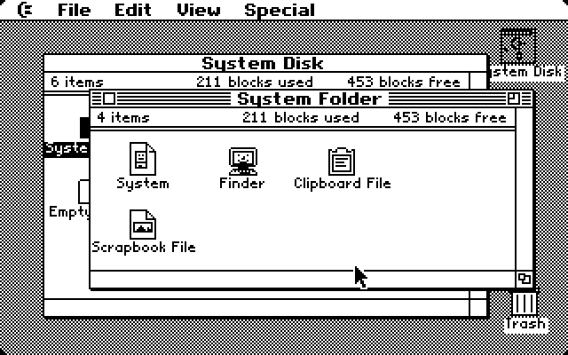
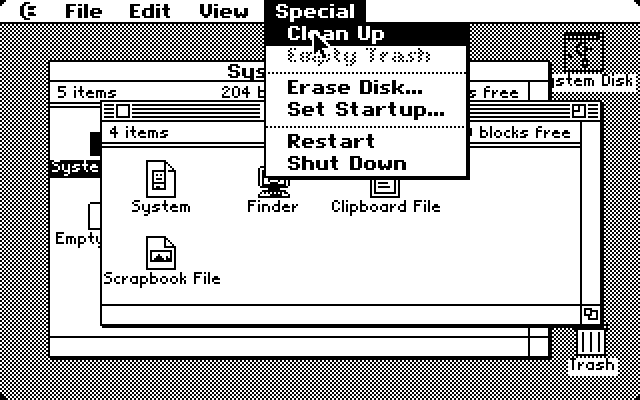
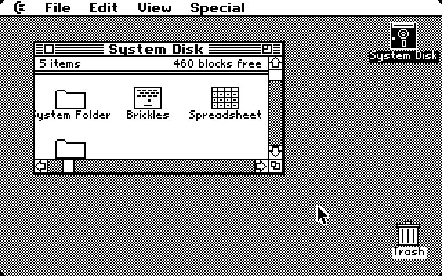
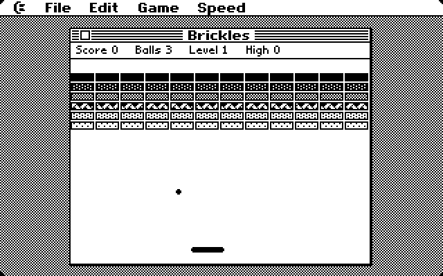
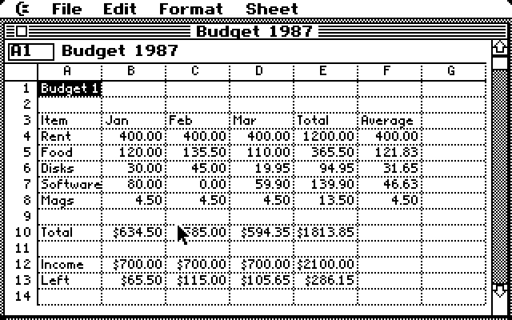
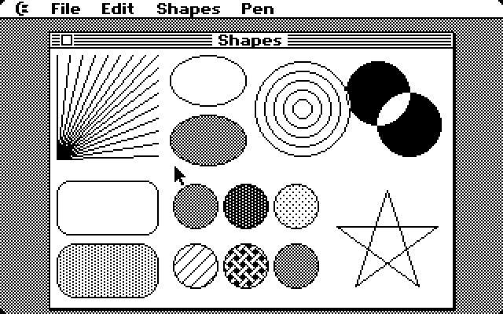

# c64_maclook

A Macintosh System 4 / Finder 5 style desktop for the **Commodore 64**, running
in 320×200 two-colour hires mode on a real 1 MHz 6510 with 64K of RAM.
Everything is written from scratch in 6502 assembly.

It has a menu bar with pull-down menus, overlapping windows, a Finder with
icons, and real applications that replace the Finder while they run, the way
the Mac worked before MultiFinder. Its files live on a
[WiC64](https://wic64.net/web/), an ESP32 Wi-Fi adapter on the user port: the
WiC64's own flash is the startup disk, and network (SMB) shares, from a PC or
a NAS, are opened from the desktop. A one-block BOOT program loads the System
from the flash, about 100 times faster than a 1541.

Like the Mac's Toolbox, the System is used only through a published API: a
jump table at a fixed address ([docs/api.md](docs/api.md)), so applications
don't need rebuilding when the System changes. Its core takes 16K; the rest of
it is loaded from the flash into an 8K block when first needed. It has a
Commodore theme: a C= logo in place of the Apple, a happy C64 at start-up.



| | |
|---|---|
|  |  |
|  |  |
|  | |

## What's in it

- **BOOT** (one block, on a floppy or a tape): loads the System from the
  share and starts it.
- **System** (a 14K core, and overlays): a QuickDraw-style graphics library
  (rectangles, lines, ovals, circles and round rects in patterns and copy,
  OR, XOR or erase modes, clipping, proportional Chicago and Geneva style
  fonts, masked icons), window manager, menu manager, alerts and dialogs,
  event handling with a 1351 mouse or joystick, the WiC64 driver and the
  file calls (list, read, write, delete, rename, copy, new folder). It
  boots, then loads the Finder.
- **Desk accessories** (Calculator, Note Pad, Puzzle, Alarm Clock, Key Caps,
  Control Panel) are out of the System for now. Their source is in
  `src/da_*.asm`; they'll come back as separate files loaded from disk.
- **Finder**: the real contents of the WiC64's volumes: the startup disk
  and network shares (double-click to connect, drag to the Trash to
  disconnect), in windows that scroll both ways. Dragging moves things
  between folders, copies them between volumes, or puts them in the Trash;
  Get Info, New Folder, Duplicate, Put Back, Empty Trash, Clean Up, renaming
  by typing, text documents, and icon positions remembered in each folder.
- **Brickles**: a Breakout game. The ball and paddle are hardware sprites.
- **Shapes**: a QuickDraw demonstration: lines, ovals, circles, round
  rects and random shapes, in a choice of patterns or inverting.
- **Spreadsheet**: a small spreadsheet with formulas (`+ - * / ( )`, cell
  references, `SUM AVG MIN MAX COUNT` over ranges), automatic recalculation,
  number formats, and Cut/Copy/Paste through the shared Clipboard.

## Quick start (macOS)

```sh
brew install acme python autoconf automake pkg-config sdl2 gtk+3
brew install imagemagick      # optional: only the screenshot tests need it

cd frodo4 && ./autogen.sh && make && cd ..   # the patched emulator
./build.sh                                    # assemble everything
./run.sh                                      # boot it
```

`run.sh` builds Frodo itself if it hasn't been built yet. The emulated WiC64
offers two folders: `flash/` as its internal flash (the startup disk, with
the System Folder and the applications, ready-made, so `./build.sh` is only
needed after changing the source) and `share/` as a network share called
Public. `desktop64.d64` holds only BOOT.

Both are ordinary folders: copy files in on the Mac and they are there on
the C64. To use a real network share in the emulator, mount it in macOS and
point Frodo at it (`WiC64Share="Name=/Volumes/..."` in `run.sh`; several
shares are separated by `;`).

### Using it

- The C64 pointer follows your Mac's pointer; there's no need to capture the
  mouse. A joystick in port 2 also works. Programs can read the mouse from a
  small block in zero page ([docs/mouse.md](docs/mouse.md)).
- **Command key = C=**, which is Alt/Option on your keyboard (e.g. C= Q quits
  an application).
- Frodo maps keys by their position on a C64 keyboard, so some symbols are in
  unexpected places: `=` is PageDown, `*` is `]`, `:` is `;`, `+` is `-`,
  and `-` is `=`.
- Double-click **Brickles**, **Spreadsheet** or **Shapes** in the System Disk
  window to launch them. Quit brings the Finder back.

### On a real C64

You need a WiC64 with the firmware in [firmware/](firmware/README.md)
(built with PlatformIO): it writes `flash/` to the WiC64's flash as the
startup disk, and serves the network shares set up on its web page. Then put
BOOT on a floppy (`desktop64.d64`) or a tape, `LOAD` it and `RUN` it. The
firmware has been tested against a simulated C64, not yet on a real WiC64.

## How it fits together

The 64K are eight 8K blocks:

```
block 0-1  $0000-$3fff  zero page, stack, BASIC's zero page copy ($0400), the
                        Clipboard ($0500), the file service's buffer ($0600),
                        then the System's core from $0801: jump table ($0810),
                        public data, code
block 2    $4000-$5fff  the System's overlays, loaded when first needed:
                        Interface ($4000: alerts, dialogs, moving and sizing
                        windows, start-up and shut-down) and Shapes ($5000:
                        lines, ovals, circles, round rects)
block 3    $6000-$7fff  the running application's core
block 4    $8000-$9fff  the application's page block
block 5    $a000-$bfff  QuickDraw's buffers: text/icon strips, shift tables
block 6    $c000-$cfff  colour matrix, pointer sprites, QuickDraw's oval
                        table, menu save-under
           $d000-$dfff  I/O; the font glyphs in the RAM underneath
block 7    $e000-$ff3f  the hires bitmap
```

Starting up: `LOAD` and `RUN` BOOT; it reads `System Folder/System.sys`
from the WiC64's flash and jumps into it. The System loads the Interface
overlay (for the start-up screen), then `System Folder/Finder.sys`.

The startup disk (volume 0, the flash):

```
System Folder/System.sys      the System's core
System Folder/Interface.ovl   overlay 1
System Folder/Shapes.ovl      overlay 2
System Folder/Finder.sys      the Finder
Brickles.app, Spreadsheet.app, Shapes.app, Read Me.txt
```

Paths start with a volume number (`1:Documents/Notes.txt`; none means the
flash). The Finder hides the extensions it knows (`.app`, `.txt`, `.sys`,
`.ovl`, `.sheet`), keeps each folder's icon positions in a hidden `.finder`
file, and the Trash in a hidden `.Trash` folder on each volume.

The WiC64 speaks its usual transfer protocol; the file service adds a few
commands to it, described in [docs/fileservice.md](docs/fileservice.md).

Overlays are called through stubs in the core: a call into an overlay that
isn't loaded loads it first, from the share, in about a tenth of a second
(`src/overlay.asm`). Each overlay starts with a table of its entry points;
`tools/mkovl.py` makes the stubs from those tables.

Applications call the System only through its jump table, and read its
public data at fixed addresses after the table. Both are described in
[docs/api.md](docs/api.md), which `tools/mkapi.py` generates along with
`build/sysapi.asm`, the include file applications are built with. New calls
are added at the end of the table, so existing applications keep working.

An application starts with a table of entry points that SYSTEM calls (see
`src/events.asm`): init, menu action, menu update, desktop draw, desktop
click, key, quit, plus pointers to its window classes, its menus and its
"About" text.

| Source | What |
|---|---|
| `src/bootstrap.asm` | BOOT |
| `src/system.asm` | the System's core: memory map and entry point |
| `src/jumptab.asm`, `src/public.asm` | the API: jump table and public data |
| `src/gfx.asm` | rectangles, patterns, clipping, text and icon blitting |
| `src/wm.asm`, `menu.asm`, `events.asm` | windows, menus, event loop |
| `src/sys.asm` | IRQ, 1351 mouse, keyboard, pointer sprites, beep |
| `src/net.asm` | the WiC64 driver and the file calls |
| `src/overlay.asm` | the overlay manager |
| `src/boot.asm` | start-up, loading and switching applications |
| `src/ovl_interface.asm`: `dialog.asm`, `wm_gestures.asm`, `startup.asm` | overlay 1 |
| `src/ovl_shapes.asm`: `qd_shapes.asm` | overlay 2: lines, ovals, circles, round rects |
| `src/fp.asm` | BASIC ROM floating point bridge |
| `src/da_*.asm` | desk accessories (not built for now) |
| `src/finder*.asm` | the Finder |
| `src/brickles*.asm`, `src/sheet*.asm`, `src/shapes_main.asm` | the applications |
| `tools/fonts.py`, `tools/icons.py` | fonts, icons and cursors drawn as ASCII art |
| `tools/mkapi.py` | publishes the API: `build/sysapi.asm`, `docs/api.md` |
| `tools/mkovl.py` | the overlays' stubs and symbol files |
| `tools/d64.py` | disk image writer |

## The patched Frodo

`frodo4/` is [Frodo 4](https://github.com/cebix/frodo4) by Christian Bauer
(upstream commit `59f096d`) with these additions, also collected in
`patches/frodo4.patch`.

- **1351 mouse emulation** (`Mouse1351=true`): the host pointer drives an
  emulated Commodore 1351 on the SID's paddle registers. Stock Frodo has no
  mouse support.
- **Mouse feedback** (`MouseSync=true`): Frodo reads the C64 driver's
  position block at `$FB`–`$FE` and sends exactly the movement that puts the
  C64 pointer on the same pixel as the host pointer, so it can't drift.
  The block and the driver are described in [docs/mouse.md](docs/mouse.md).
- **WiC64** (`WiC64=true WiC64Share=folder`): a WiC64 on the user port,
  speaking its transfer protocol, with a few of its standard commands and
  the file service ([docs/fileservice.md](docs/fileservice.md)) on a folder
  of the host.
- **Test-bench scripting** (`TestInput=script.txt` with `TestBench=true`): a
  frame-by-frame script of `mouse x y`, `down`/`up`, `keydown`/`keyup`
  (SDL key names or raw scancode numbers), `type text`, `shot file.bmp`,
  `dump file.bin` (64K RAM and CPU registers) and `quit`.

## Testing

Everything was developed headlessly with those scripts:

```sh
python3 tools/mkscript.py tests/calc.dsl tests/calc.txt   # small DSL -> script
tools/shot.sh tests/smoke.txt build/pub_ 630             # run, save screenshots
python3 tools/peek.py build/b5.bin app_loaded zcount     # inspect a RAM dump
```

`tools/fixbranches.py` rewrites 6502 branches that ACME reports as out of
range. The WiC64 firmware has its own test bench, on the host
(`firmware/test/run.sh --smb`; see [firmware/README.md](firmware/README.md)).

## Known issues

- The Finder uses all of blocks 3 and 4; it needs the paging planned for
  applications before it can grow. Applications show a generic icon (their
  own icons, read from the application files, are to come).
- Documents can't be saved yet.
- The WiC64 firmware hasn't been tried on a real WiC64 yet.
- View by Name/Date/Size/Kind, Print and Erase Disk are not implemented.

## Credits

A fan-made tribute to the original Macintosh Finder by Bruce Horn and Steve
Capps. Not affiliated with Apple or Commodore. Frodo 4 is by Christian Bauer
and licensed under GPL-2.0; the C64 ROM images in `frodo4/src` are as
published in upstream Frodo. Assembled with [ACME](https://sourceforge.net/projects/acme-crossass/).
The WiC64 firmware uses [libsmb2](https://github.com/sahlberg/libsmb2) by
Ronnie Sahlberg (LGPL-2.1), fetched when it is built.

Built by Tony Weston with Claude Code.
