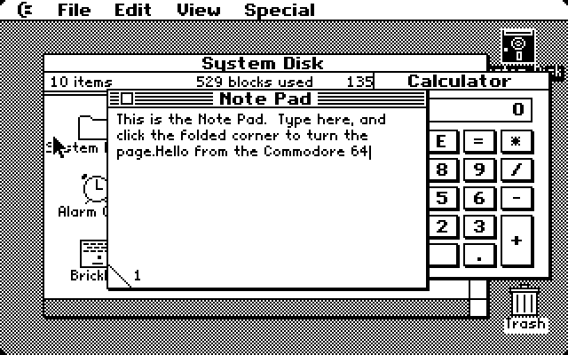

# c64_maclook

A Macintosh System 4 / Finder 5 style desktop for the **Commodore 64**, running
in 320×200 two-colour hires mode on a real 1 MHz 6510 with 64K of RAM.
Everything is written from scratch in 6502 assembly.

It has a menu bar with pull-down menus, overlapping windows, a Finder with icons,
desk accessories, and real applications loaded from a 1541 disk that replace
the Finder while they run, the way the Mac worked before MultiFinder. It has
since been given a Commodore theme: a C= logo in place of the Apple, a happy
C64 at start-up, a 1541 floppy icon, and disk space counted in blocks.


| | |
|---|---|
|  |  |
|  |  |

## What's in it

- **SYSTEM** (the boot file): a QuickDraw-style graphics library (patterns,
  clipping, proportional Chicago and Geneva style fonts, masked icons), window
  manager, menu manager, alerts and dialogs, event handling with a 1351 mouse
  or joystick, and a loader that brings applications in from drive 8.
- **Desk accessories** in the C= menu: Calculator (real floating point from
  the BASIC ROM), Note Pad, Puzzle, Alarm Clock, Key Caps, Control Panel
  (desktop pattern editor, volume, blink rates, double-click speed).
- **FINDER**: disk and folder windows, dragging icons between folders and to
  the Trash, Get Info, New Folder, Duplicate, Put Back, Clean Up, renaming
  icons by typing, zoom-rect animations, Restart and Shut Down.
- **BRICKLES**: a Breakout game. The ball and paddle are hardware sprites.
- **SHEET**: a small spreadsheet with formulas (`+ - * / ( )`, cell
  references, `SUM AVG MIN MAX COUNT` over ranges), automatic recalculation,
  number formats, and Cut/Copy/Paste through the shared Clipboard.

## Quick start (macOS)

```sh
brew install acme python autoconf automake pkg-config sdl2 gtk+3
brew install imagemagick      # optional: only the screenshot tests need it

cd frodo4 && ./autogen.sh && make && cd ..   # the patched emulator
./build.sh                                    # assemble everything -> desktop64.d64
./run.sh                                      # boot it
```

`run.sh` builds Frodo itself if it hasn't been built yet. A ready-made
`desktop64.d64` is included, so `./build.sh` is only needed after changing
the source.

`./run.sh` uses Frodo's fast disk mode. `./run.sh real` uses full,
cycle-exact 1541 emulation: authentic, but booting takes about a minute.

### Using it

- The C64 pointer follows your Mac's pointer; there's no need to capture the
  mouse. A joystick in port 2 also works. Programs can read the mouse from a
  small block in zero page ([docs/mouse.md](docs/mouse.md)).
- **Command key = C=**, which is Alt/Option on your keyboard (e.g. C= Q quits
  an application).
- Frodo maps keys by their position on a C64 keyboard, so some symbols are in
  unexpected places: `=` is PageDown, `*` is `]`, `:` is `;`, `+` is `-`,
  and `-` is `=`.
- Double-click **Brickles** or **Spreadsheet** in the System Disk window to
  launch them. Quit brings the Finder back.

## How it fits together

```
$0002-$008f  zero page (ours; $90-$ff stay the KERNAL's for disk loading)
$0400-$04ff  BASIC's zero page, saved so the floating point ROM can be used
$0500-$05ff  the Clipboard
$0801-       SYSTEM
$6800-$9fff  the running application (FINDER, BRICKLES or SHEET)
$a000-$bfff  text/icon blitting buffers and shift tables
$c000-$cfff  colour matrix, pointer sprites, menu save-under buffer
$e000-$ff3f  the hires bitmap
```

The C64 boots SYSTEM with `LOAD"*",8,1`. SYSTEM then loads FINDER with the
KERNAL's LOAD while showing "Welcome to Commodore 64." An application starts
with a table of entry points that SYSTEM calls (see `src/events.asm`):
init, menu action, menu update, desktop draw, desktop click, key, quit, plus
pointers to its window classes, its menus and its "About" text. Applications
are linked against SYSTEM's symbol table when they're built.

| Source | What |
|---|---|
| `src/system.asm` | SYSTEM: memory map and entry point |
| `src/gfx.asm` | rectangles, patterns, clipping, text and icon blitting |
| `src/wm.asm`, `menu.asm`, `dialog.asm`, `events.asm` | windows, menus, dialogs, event loop |
| `src/sys.asm` | IRQ, 1351 mouse, keyboard, pointer sprites, beep |
| `src/loader.asm`, `boot.asm` | disk loading, start-up, app switching |
| `src/da_*.asm`, `fp.asm` | desk accessories, BASIC ROM floating point bridge |
| `src/finder*.asm` | the Finder |
| `src/brickles*.asm`, `src/sheet*.asm` | the applications |
| `tools/fonts.py`, `tools/icons.py` | fonts, icons and cursors drawn as ASCII art |
| `tools/d64.py`, `tools/linksym.py` | disk image writer, symbol linking for apps |

## The patched Frodo

`frodo4/` is [Frodo 4](https://github.com/cebix/frodo4) by Christian Bauer
(upstream commit `59f096d`) with two additions. They're shown as one commit
in this repo's history, and also as `patches/frodo4-mouse1351-testbench.patch`.

- **1351 mouse emulation** (`Mouse1351=true`): the host pointer drives an
  emulated Commodore 1351 on the SID's paddle registers. Stock Frodo has no
  mouse support.
- **Mouse feedback** (`MouseSync=true`): Frodo reads the C64 driver's
  position block at `$FB`–`$FE` and sends exactly the movement that puts the
  C64 pointer on the same pixel as the host pointer, so it can't drift.
  The block and the driver are described in [docs/mouse.md](docs/mouse.md).
- **Test-bench scripting** (`TestInput=script.txt` with `TestBench=true`): a
  frame-by-frame script of `mouse x y`, `down`/`up`, `keydown`/`keyup`
  (SDL key names or raw scancode numbers), `type text`, `shot file.bmp`,
  `dump file.bin` (64K RAM and CPU registers) and `quit`.

## Testing

Everything was developed headlessly with those scripts:

```sh
python3 tools/mkscript.py tests/calc.dsl tests/calc.txt   # small DSL -> script
tools/shot.sh tests/smoke.txt build/pub_ 630             # run, save screenshots
python3 tools/peek.py build/b5.bin app_loaded zcount     # inspect a RAM dump
```

`tools/fixbranches.py` rewrites 6502 branches that ACME reports as out of
range.

## Known issues

- The Alarm Clock freezes the machine when its seconds change.
- The Finder's disk contents are a built-in table, not the real 1541
  directory, so moved, renamed or trashed icons are forgotten on Restart or
  when switching applications. Documents can't be saved yet.
- View by Name/Date/Size/Kind, Print and Erase Disk are not implemented.

## Credits

A fan-made tribute to the original Macintosh Finder by Bruce Horn and Steve
Capps. Not affiliated with Apple or Commodore. Frodo 4 is by Christian Bauer
and licensed under GPL-2.0; the C64 ROM images in `frodo4/src` are as
published in upstream Frodo. Assembled with [ACME](https://sourceforge.net/projects/acme-crossass/).

Built by Tony Weston with Claude Code.
