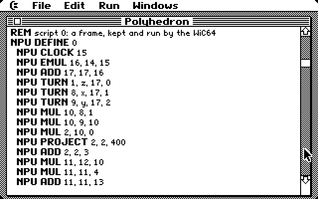
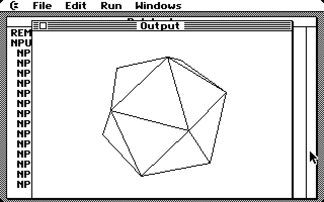

# BASIC

A BASIC for the desktop, after the Macintosh's Microsoft BASIC and
QuickBASIC. You type the program in a **Listing** window, where line numbers
are optional and keywords show in bold, and it runs in an **Output** window
while the menus and windows keep working. The language is the C64's own
**Commodore BASIC V2**: the BASIC ROM runs the program, so everything a C64
owner knows works. BASIC adds statements for drawing, and an `NPU`
statement for the WiC64's matrix unit ([npu.md](npu.md)).



## Using it

Open the BASIC folder on the startup disk and double-click BASIC, or
double-click a `.bas` document anywhere (the flash or a network share).

| Menu | |
|---|---|
| File | New, Open…, Save, Save As…, Quit. Programs are saved as their listing, plain text with one line to a CR, so they can be edited on a PC too. Quit and New ask about unsaved changes. |
| Edit | Cut Line, Copy Line, Paste, Clear Line, through the shared Clipboard. |
| Run | Start (C= R), Stop (C= .). |
| Windows | Listing (C= L), Output (C= W). |

The About box shows the bytes free.

In the Listing, Return splits a line and Delete at the start of a line joins
it to the one above. The cursor keys and the mouse move the caret, and the
scroll bar scrolls. The line being edited shows as plain text; when the caret
leaves it, it's tokenized into the program and shown with its keywords in
bold. A mistake that isn't BASIC is found when the line runs, as on a C64.

`INPUT` waits for a line typed in the Output window. `GET` reads the keys
pressed while the Output window is in front. An error stops the program and
BASIC's message comes up in an alert, such as "Syntax error in line 3.". The
Listing then shows that line inverted. A line with a number of its own is
named by that number; any other line is named by its position in the
listing.

## Line numbers

Line numbers are optional. A line needs one only when it's the target of a
`GOTO`, `GOSUB`, `THEN` or `RUN`, and it goes in front as usual. They range
from 0 to 999, in any order you like.

```basic
s = 0
10 INPUT "A number (0 to stop)"; n
IF n = 0 THEN 20
s = s + n: GOTO 10
20 PRINT "The total is"; s
```

Inside, the program is in BASIC V2's own format: a number n is stored as
n × 64, and the lines without one get the numbers in between. That's why the
largest is 999.

## The language

All of BASIC V2 works:

- `PRINT`, `INPUT`, `GET`, `IF … THEN`, `FOR … NEXT`, `GOTO`, `GOSUB`,
  `ON … GOTO/GOSUB`, `DIM`, `DATA`, `READ`, `RESTORE`, `DEF FN`, `END`,
  `STOP`, `REM`, and `'` for `REM`.
- `?` for `PRINT`.
- The functions, strings, arrays and floating point.
- `TI` and `TI$`, which count with the System's clock.
- `PEEK`, `POKE` and `SYS` are there, but a careless `POKE` can bring the
  desktop down.

Device statements are not available, because files belong to the desktop:
`LOAD`, `SAVE`, `VERIFY`, `OPEN`, `CLOSE`, `CMD`, `PRINT#` and `INPUT#`.
Neither are the direct-mode commands `LIST`, `NEW`, `CLR`, `CONT` and
`RUN` (the Run menu starts a program).

`CHR$(147)` and `CLS` clear the Output window. Text is in the System's
proportional font, 16 rows of up to 48 characters; the window scrolls when
it's full.

## Drawing

Drawing statements draw in the Output window. Coordinates are measured from
its content's top left. The colour is 0 for white and anything else for
black, which is the default.

| Statement | |
|---|---|
| `CLS` | clear the window |
| `PSET (x, y) [, c]` | a pixel |
| `LINE (x1, y1)-(x2, y2) [, c] [, B \| BF]` | a line, or a box (`B`), or a filled box (`BF`) |
| `CIRCLE (x, y), r [, c]` | a circle, radius up to 255 |
| `BEEP` | the System beep |

A drawing statement waits until the Output window is in front and its text
is drawn, so it never draws over another window.

```basic
CLS
FOR r = 10 TO 70 STEP 10
CIRCLE (128, 82), r
NEXT
LINE (8, 8)-(248, 156), , B
```

The window's content is about 256 × 164 pixels; drawing outside it is
clipped.

## The matrix unit

`NPU` sends instructions to the WiC64's matrix unit. The unit keeps 32
matrix registers and 8 scripts on the ESP32, so data is loaded once and
then worked on with short instructions. Operands are BASIC expressions, and
the first `NPU` statement of a run empties the unit (`RESET`). The
instructions themselves are described in [npu.md](npu.md).

| Statement | |
|---|---|
| `NPU LOAD r, A [, n]` | array `A` into register `r`: `A(i, j)` is row `i`, column `j`, and a one-dimensional array is one row. With `n`, only the first `n` columns are sent. Arrays of numbers get a fixed-point scale picked to fit their largest value; integer arrays (`A%`) are sent as whole numbers. |
| `NPU STORE r, A [, f]` | register `r` back into `A`, which must be the same size. `f` is the number of fraction bits (default 8). |
| `NPU DEFINE s` … `NPU END` | the `NPU` statements in between aren't run but recorded as script `s` (up to 250 bytes), which is kept on the WiC64 |
| `NPU DRAW s` | run script `s`; the bytes it `SEND`s go straight into the Output window. The unit is told where the window is (`SCREEN`) whenever it has moved. |
| `NPU SCREEN x, y, w, h` | draw in just that part of the Output window |
| `NPU name operands` | any other instruction, by its name: `ADD d, a, b`, `MUL d, a, b`, `ROTATE r, axis, angle` (radians), `TURN`, `PROJECT`, `APPLY`, `PICK`, `CLOCK`, `LINES`, `CLEAR`, `SEND`… |

Axes, functions and other choices are numbers, so programs name them with
variables (`x = 0: y = 1: z = 2`). If the WiC64 refuses an instruction, the
program stops with its message, for example
`WiC64: Instruction 1 (MUL): a register is empty`.

A small example: a matrix times a vector.

```basic
DIM m(1, 1), v(1, 0), r(1, 0)
m(0, 0) = 2: m(1, 1) = 3: v(0, 0) = 5: v(1, 0) = 7
NPU LOAD 0, m
NPU LOAD 1, v
NPU MUL 2, 0, 1
NPU STORE 2, r
PRINT r(0, 0), r(1, 0)
```

### Polyhedron.bas



`Polyhedron.bas` on the startup disk is the Polyhedron application written
in BASIC: a cube, an octahedron and an icosahedron tumbling in perspective,
with the back edges hidden. Press 1 to 3 for a solid, H to show the back
edges, and Q to stop.

1. It reads a solid's corners, faces and edges from `DATA` into integer
   arrays and `NPU LOAD`s them into registers.
2. Between `NPU DEFINE 0` and `NPU END` is the frame:
   - `CLOCK` measures the time since the last frame, and `EMUL` and `ADD`
     turn the angles by speed × time.
   - `TURN` and `MUL` rotate the corners, and `PROJECT` puts them in
     perspective.
   - `MUL`, `APPLY` and `PICK` work out which edges belong to faces turned
     towards you.
   - `CLEAR`, `LINES` and `SEND` draw it and send back the changes.
3. The main loop is two lines:

   ```basic
   20 NPU DRAW 0
   GET k$
   ```

It runs at 51 frames a second for the cube and 28 for the icosahedron in the
emulator, about as fast as the assembly language Polyhedron. The program is
made by `tools/polyhedron_bas.py` from the solids in `tools/solids.py`.

## How it works

- **The ROM interpreter.** The program is kept in BASIC V2's format, and the
  BASIC ROM runs it, in slices of 8 frames from the Output window's idle
  call. Between slices, the menus, windows and the rest of the desktop run as
  usual.
- **Zero page and stack.** BASIC's zero page and the System's overlap, so
  they're swapped at every slice, using a copy at `basic_zp` (`$0400`).
  BASIC's part of the stack (FOR and GOSUB entries, calls in progress) is
  copied out when a slice ends and back when the next starts.
- **Hooks.** BASIC's vectors are pointed at BASIC's own code:
  - `IGONE` (`$0308`) sees every statement. That's where the slice ends, the
    new statements run and the blocked ones are refused.
  - `IERROR` (`$0300`) reports errors.
  - The KERNAL's `CHROUT`, `CHRIN` and `GETIN` connect `PRINT`, `INPUT` and
    `GET` to the Output window.
- **Interrupts** stay on. With the KERNAL banked in they come through
  `$0314`, where the System's own interrupt routine runs with its zero page
  swapped back in.
- **Memory.** BASIC is 15K of code, so it starts at `$5000`, the Shapes
  overlay's half of block 2: BASIC draws its own lines and circles and never
  calls that overlay. The program, its variables, arrays and strings take
  the rest, up to `$A000`: 5,304 bytes.
- **Keywords.** Lines are tokenized with the ROM's own keyword table, plus
  the new statements (`CLS` `$CC`, `PSET`, `LINE`, `CIRCLE`, `BEEP`,
  `NPU` `$D1`).

| Source | |
|---|---|
| `src/basic_main.asm` | the application: memory, menus, windows |
| `src/basic_edit.asm` | the Listing window and the program store |
| `src/basic_tok.asm` | tokenizing and listing lines |
| `src/basic_run.asm` | running the program with the BASIC ROM |
| `src/basic_out.asm` | the Output window and the drawing statements |
| `src/basic_npu.asm` | the `NPU` statements |
| `src/basic_file.asm` | Open, Save and their dialogs |
| `src/basic_str.asm` | menus and messages |

## Limits

- Line numbers go from 0 to 999.
- Lines can be up to 160 characters; long lines are cut off at the window's
  right edge, because the Listing doesn't scroll sideways yet.
- The Listing holds up to 250 lines. Redrawing a full window of listing
  takes almost a second.
- 5,304 bytes for the program and its variables.
